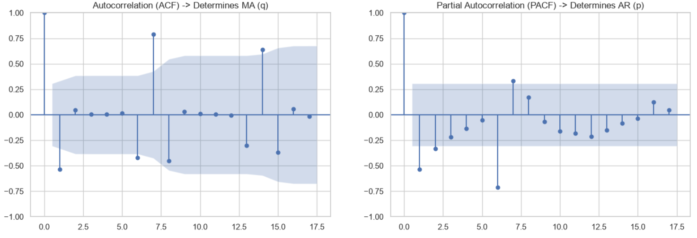

# 🏪 Rossmann Store Sales Time Series Forecasting

A complete end-to-end time series analysis and forecasting pipeline built in Python to predict daily sales for individual retail stores using historical Rossmann store data. This project implements data cleansing, time series decomposition, baseline benchmarking, stationarity testing, and advanced modeling via **SARIMAX**.

---

## 🚀 Project Overview

Accurate retail sales forecasting is critical for optimizing inventory, scheduling staff, and planning marketing campaigns. This project focuses on **Store #1** from the Rossmann dataset, transforming raw transactional records into a rigorous predictive pipeline:
1. **Data Preprocessing & Hygiene**: Handling closed days, establishing continuous daily frequency grids, and resolving missing timeline gaps.
2. **Exploratory Data Analysis & Decomposition**: Visualizing sales trends and isolating weekly (7-day) and annual (365-day) seasonality.
3. **Baseline Benchmarking**: Establishing baseline performance metrics using Naive, Seasonal Naive, Moving Average, and Drift models.
4. **Stationarity & Feature Identification**: Running Augmented Dickey-Fuller (ADF) tests, differencing, and utilizing ACF/PACF diagnostic plots.
5. **Advanced Modeling (SARIMAX)**: Fitting a Seasonal Autoregressive Integrated Moving Average model, evaluating test holdout performance, inspecting residuals, and generating future forecasts with confidence intervals.

---

## 📊 Methodology & Key Steps

### Step 1: Data Preparation & Cleaning
* **Store Filtering**: Isolated data specifically for **Store 1**.
* **Handling Closed Days**: Sales on days the store was closed (`Open == 0`) were explicitly mapped to `0`.
* **Frequency Enforcement**: Enforced a strict daily sequence (`asfreq('D')`) and filled missing timeline entries to guarantee uninterrupted temporal structure.

### Step 2: Time Series Decomposition
An **additive decomposition model** was applied to capture cyclic patterns:
* **Weekly Pattern**: Highlighted strong intra-week fluctuations, with Sunday consistently representing zero/closed sales and high activity early in the week.
* **Annual Seasonality**: Mapped day-of-year effects to reveal long-term yearly behavioral trends.

### Step 3: Baseline Evaluation (6-Week Holdout)
The final 42 days (6 weeks) were held out as a test set to evaluate baseline strategies:
* **Naive Forecast**: Uses the last observed value.
* **Seasonal Naive**: Uses values from exactly one seasonal cycle prior.
* **Moving Average (14-day)**: Smooths out volatility using a rolling window.
* **Drift Forecast**: Extrapolates historical linear trends.

| Baseline Model | MAE | RMSE |
| :--- | :--- | :--- |
| **Naive** | 1,150.57 | 1,734.59 |
| **Seasonal Naive** | **721.81** | **1,268.10** |
| **Moving Average (14d)** | 1,223.39 | 1,684.42 |
| **Drift** | 1,136.07 | 1,754.76 |

> *Insight*: Seasonal Naive heavily outperforms standard naive models, proving the dominance of weekly seasonality in retail foot traffic.

### Step 4: Stationarity & Order Identification
* **ADF Test**: Confirmed stationarity parameters on differenced series ($p < 0.01$).
* **ACF & PACF Diagnostics**: Inspected autocorrelation and partial autocorrelation charts to determine optimal AR ($p$), MA ($q$), and differencing ($d$) orders.

### Step 5: Final SARIMAX Model & Evaluation
A **$SARIMAX(1,1,1) \times (1,1,1)_7$** model was trained on historical data up to June 2015 and evaluated against the 6-week test window.

* **Model Performance Metrics**:
  * **MAE**: $605.87$ (A significant improvement over baseline models)
  * **RMSE**: $723.69$

---

## 🛠️ Tech Stack & Libraries

* **Language**: Python 
* **Data Manipulation**: `pandas`, `numpy`
* **Visualization**: `matplotlib`, `seaborn`
* **Time Series & Modeling**: `statsmodels` (`seasonal_decompose`, `adfuller`, `plot_acf`, `plot_pacf`, `SARIMAX`)
* **Metrics**: `scikit-learn` (`mean_absolute_error`, `root_mean_squared_error`, `mean_absolute_percentage_error`)

---

## 📈 Results & Visualizations



### Final Six-Week Forecast Matrix Sample
```python
            Forecasted Sales  Lower CI (95%)  Upper CI (95%)
Date                                                        
2015-06-20           4696.45         2433.77         6959.14
2015-06-21           -284.77        -2606.27         2036.73
2015-06-22           4538.33         2207.98         6868.67
2015-06-23           4334.14         1999.26         6669.03
2015-06-24           4167.33         1828.54         6506.11
